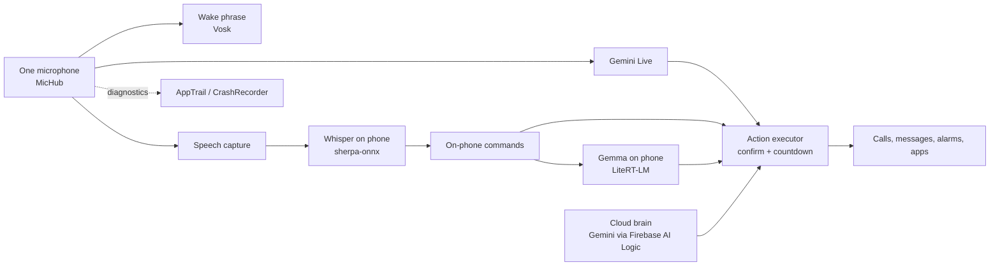

<div align="center">

# MochiLife

**A voice-first AI companion for Android: say her name, say what you need, and she does it.**

[](LICENSE)


[](https://github.com/MagiCoders/neo-companion/actions/workflows/ci.yml)

[Features](#what-it-does) · [Architecture](#architecture) · [Build](#build-it-yourself) · [Security](SECURITY.md) · [Contributing](CONTRIBUTING.md) · [Changelog](CHANGELOG.md)

</div>

Call someone, send or read a message, set an alarm, open an app, play a video, or just talk. Built with Kotlin and Jetpack Compose, with a 3D character that reacts while she listens, thinks and speaks. Wake phrase: **"Hi Elza"**. Languages: English, Arabic (including everyday dialect) and Persian.

> **Status:** pre-release (version 3.3). Tested so far on one phone (Samsung Galaxy S22+). It has no public users yet, so there are no download numbers.

## What it does

- **Hands-free by voice.** An always-on wake phrase ("Hi Elza") opens a request; one microphone feeds wake-word detection, the request and the live conversation, so she never answers her own voice.
- **Real phone actions, confirmed first.** Calls, messages, alarms, timers, opening apps and video search resolve against the user's real contacts and apps. Every action goes through a short countdown the user can cancel. Nothing is hard-coded or simulated.
- **English, Arabic (including everyday dialect) and Persian** for listening, answering and speaking.
- **Two brains.** Cloud (Gemini through Firebase AI Logic, including a low-latency Live conversation) or **on the phone with no internet** (Gemma 4 through LiteRT-LM, with Whisper through sherpa-onnx as the listener). The engine can be set to automatic, cloud or phone.
- **Private by design.** See [SECURITY.md](SECURITY.md): HTTPS only, encrypted personal data (Android Keystore), no AI key in the app, Firebase App Check, strict Firestore rules with emulator tests, and prompt-injection defences for messages from other people.
- **Honest diagnostics.** An on-phone voice log, a crash recorder (why the app last closed, with no speech recorded) and a performance view, all copyable by the user.

## Who it is for

People who find a touch screen slow or hard to use (low vision, limited hand use, driving, cooking, older users) and anyone who wants one companion that can do things instead of only answering. It has been designed around voice, but it has **not yet been evaluated with users who rely on screen readers or other assistive technology**; that is the next piece of work, not a claim.

## Architecture



## Repository map

| Path | What is in it |
| --- | --- |
| `app/src/main/java/com/example/ai` | Voice pipeline, cloud and on-phone brains, offline Whisper and Gemma |
| `app/src/main/java/com/example/actions` | Real phone actions (contacts, calls, WhatsApp, alarms, apps) |
| `app/src/main/java/com/example/ui` | Jetpack Compose screens, 3D characters, theme |
| `app/src/main/java/com/example/diag` | Crash recorder, app trail, exit reasons (no speech recorded) |
| `app/src/main/java/com/example/security` | Encrypted storage on the Android Keystore |
| `app/src/test` | Unit tests (voice, parsing, diagnostics, Firestore rules) |
| `firestore.rules`, `firestore.test.js` | Database security rules and their tests |
| `tools/` | Asset preparation scripts (3D models, wake-word graph) |
| `docs/` | Product documentation, design notes and mockups, development briefs |

## Build it yourself

This repository contains **no credentials**. To run your own copy you must bring your own keys:

- **Firebase** (required): create your own project and download your own `google-services.json` into `app/`. It is git-ignored; `app/google-services.json.example` shows its shape.
- **Gemini** (optional, cloud mode): used through Firebase AI Logic in *your* Firebase project, so you enable it there. There is no Gemini key in the app.
- **On-phone mode** needs no keys; models are downloaded in the app.

Requirements: Android Studio, JDK 21, a phone or emulator (Android 7.0+, API 24).

1. Add an Android app to your Firebase project with package `com.aistudio.cadence.mxkprz` (or change the application id).
2. Put its `google-services.json` in `app/`.
3. Enable Authentication (Google), Cloud Firestore and Firebase AI Logic. Deploy the rules: `firebase deploy --only firestore:rules`.
4. Run `./gradlew :app:assembleDebug`. Debug builds use the App Check debug provider.

There is no Gemini API key in the app or in this repository. The on-phone models (Gemma, Whisper) are downloaded by the user from Hugging Face inside the app (Settings → Gemma Lab).

Do not change the `signingConfigs` in `app/build.gradle.kts`; release signing uses environment variables.

## Tests

```
./gradlew :app:testDebugUnitTest
firebase emulators:exec --only firestore,auth --project demo-test "./gradlew :app:testDebugUnitTest"
```

About 110 unit tests (voice pipeline, command parsing, security rules, diagnostics). They run without a phone.

## More

- [CHANGELOG.md](CHANGELOG.md): every version, in plain words
- [docs/ROADMAP.md](docs/ROADMAP.md): what is next and where help is welcome
- [SECURITY.md](SECURITY.md): protections, reporting, console steps
- [CONTRIBUTING.md](CONTRIBUTING.md) · [CODE_OF_CONDUCT.md](CODE_OF_CONDUCT.md)
- [docs/](docs): [product documentation](docs/product-documentation.md), [design](docs/design), [development briefs and launch plan](docs/development)

## License

Apache License 2.0. See [LICENSE](LICENSE) and [NOTICE](NOTICE) (third-party components and models keep their own licences).
